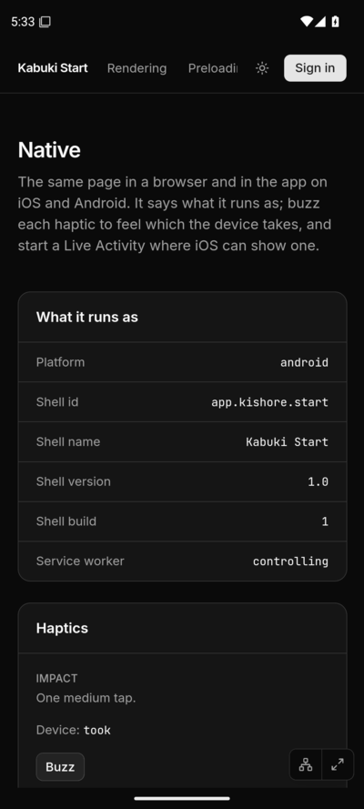
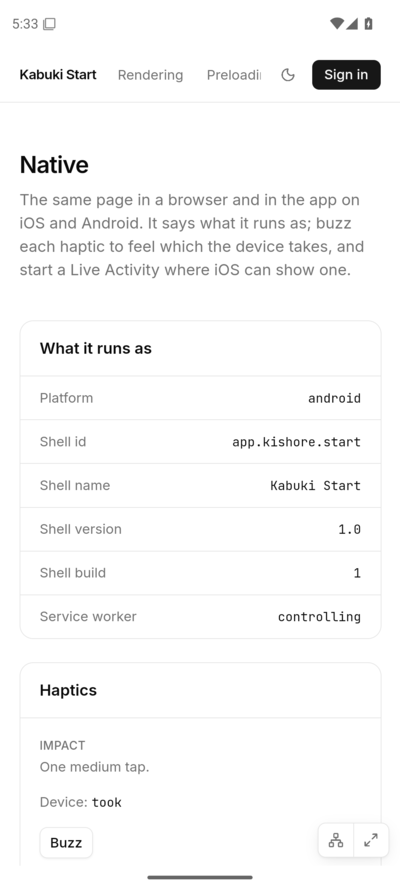
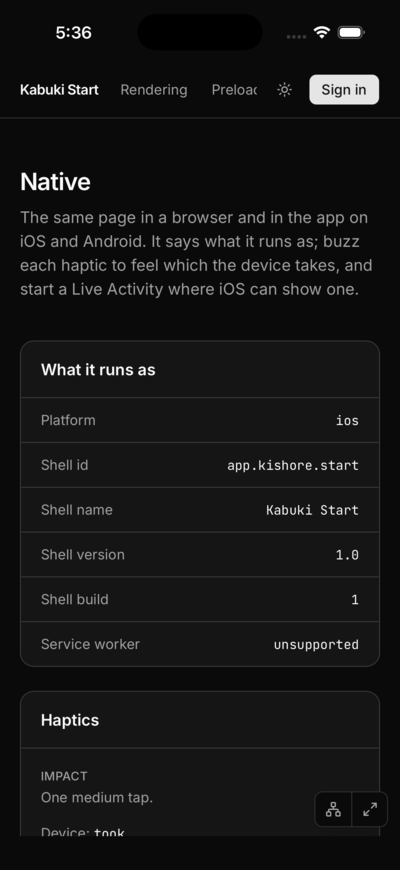
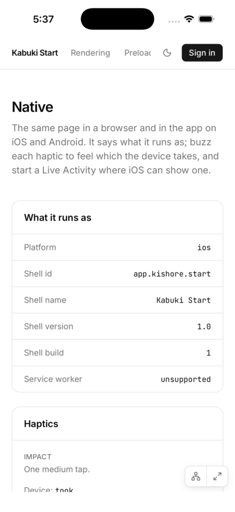
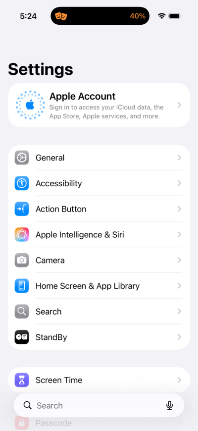
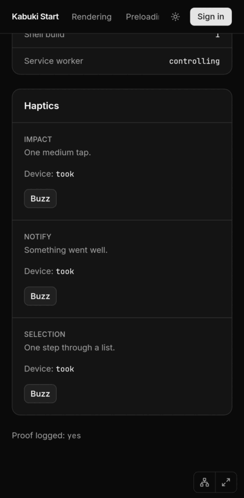
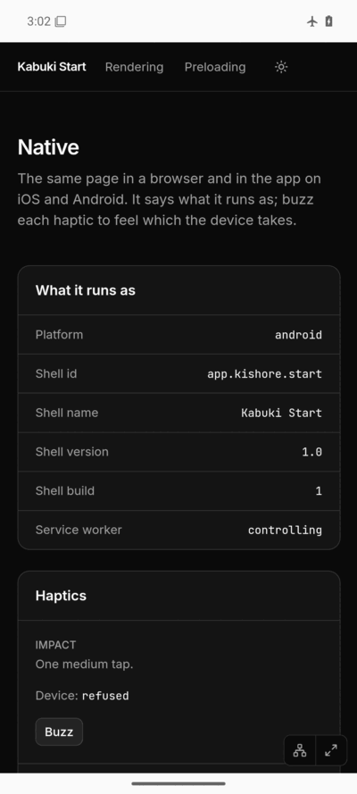

# Findings: Kabuki Start in a Capacitor shell

What the spike learned, November 2026. **Seen in CI** means a
[`native-kabuki-start.yml`](../../../.github/workflows/native-kabuki-start.yml)
job showed it, against the pull request's preview
(`https://pr139-start.kishore.app/native?proof=1`). The first sections came
from [run 43548855640](https://github.com/pkishorez/monorepo/actions/runs/43548855640)
and [run 43546197876](https://github.com/pkishorez/monorepo/actions/runs/43546197876);
the bars and the Live Activity from
[run 43561720109](https://github.com/pkishorez/monorepo/actions/runs/43561720109),
where all three jobs passed, and the Dynamic Island photo from
[run 43560772240](https://github.com/pkishorez/monorepo/actions/runs/43560772240).
**Not verified** means nobody has seen it.

| Android, dark                               | Android, light                                | iOS, dark                           | iOS, light                            | Dynamic Island                                                      |
| ------------------------------------------- | --------------------------------------------- | ----------------------------------- | ------------------------------------- | ------------------------------------------------------------------- |
|  |  |  |  |  |

## The bars: the shell keeps the page out of them

Seen in CI, on both platforms, in both Themes. Before, iOS drew the page
under the clock and the Dynamic Island, and Android put a white band above a
dark page. Now the page stays full-screen and unaware (its
`env(safe-area-inset-*)` are zero) and the shell keeps the web view between
the system bars, painting them in the page's `theme-color`, as Safari does:

- iOS: `ShellViewController`, the app's root, holds Capacitor's view
  controller as a child pinned to the safe area (Capacitor's `loadView` is
  final and makes the web view the whole screen, so it cannot be inset from
  inside). Its background is `WKWebView.themeColor`, observed; the clock and
  battery go dark or light from the color's luminance. Hiding the bars, the
  home indicator and the orientations are still asked of Capacitor's
  controller, as when it was the root, read from its source. A page call to
  Capacitor's `SystemBars.setStyle` is now ignored on iOS: the shell decides.
- Android: Capacitor's `SystemBars` is off (`insetsHandling: 'disable'`).
  The site asks for `viewport-fit=cover`, and on WebView 140 and later
  `SystemBars` then hands the bars to the page instead of padding the web view,
  whatever `css` or `native` says (read in its source; the emulator has
  WebView 124, so CI did not see that case). A small `ShellBars` plugin in the
  app pads the window by the bars' insets and paints it; Android's web view
  has no `themeColor`, so it injects a script that watches the tag and
  reports `#rrggbb` through a JavaScript interface.
- Before the page draws, both use the site's dark default (`#0a0a0a`, also
  Capacitor's `backgroundColor`): no white flash. The launch screens are
  untouched.

The check reads the screenshots with Node alone (`scripts/png.mjs`): each
Theme's status bar band and bottom band must be mostly the Theme's color
(80% and 100% on iOS, where the island takes the rest; 98% and 96% on
Android), the shell must report that color, and on iOS the web view must
start at the safe area (186 px of 2622). The color alone is not enough
evidence: the old dark iOS screenshot passes it at the top (70%), because
the site's header is the same color as its page; the web view's position and
the light Theme are what tell.

Not verified: rotation, the keyboard (the shell pads for it as Capacitor
does), a WebView of 140 or later, a page whose `theme-color` has a `media`.
To make this a package, the iOS controller and the Android plugin would move
into a Capacitor plugin with a small iOS class an app names in its
`SceneDelegate`, and the Android part registered as any plugin is; the
`SystemBars` setting would stay the app's to set.

## Live Activity: a plugin of our own

Seen in CI, on iOS 26 in an iPhone Pro simulator. With `live=1` the page
called `start`, the plugin returned an id, and the app printed

```
[live-activity] started 43D0DDBA-7098-40EF-93C6-C782B1AFCCA2 active
[live-activity] background 43D0DDBA-7098-40EF-93C6-C782B1AFCCA2 active
```

the second when Settings came to the front: iOS's own list of the app's
activities still had it, running. The job fails without both. The photo
shows the compact view in the island: the masks on the left, `40%` on the
right. The Lock Screen, the expanded view (a long press) and the minimal
view (two activities at once) were not photographed. In the second photo, in
run 43561720109, the island was still animating at five seconds; the wait is
now eight.

- [`@kestack/capacitor-live-activity`](../../../packages/capacitor-live-activity)
  is the plugin: Swift only, `isSupported`, `start`, `update`, `end` and
  `list` with ActivityKit, guarded for iOS 16.2. The app's deployment target
  stays 15.0: raising it would drop iOS 15 phones for one feature. Whether an
  iOS 15 phone still opens the app (ActivityKit linked weakly) is not
  verified.
- `cap sync` found it through the `workspace:*` link exactly as it finds
  the official plugins: the path in `CapApp-SPM/Package.swift` is the real
  one (`../../../../../packages/capacitor-live-activity`), and the plugin
  class came from the Swift source. Two rules are the CLI's, read in its
  source: the Swift package and product must be named after the npm name
  (`KestackCapacitorLiveActivity`), and it lists the first `@objc(…)` of
  every Swift file as a plugin class, so only the plugin's file may have one.
  `cap sync android` skips it, as it has no Android.
- The activity's type, `LiveActivityAttributes`, is defined once, in a second
  product of the same package, `LiveActivityModel`, with no Capacitor in it.
  The plugin links it through CapApp-SPM and the widget extension links it
  directly, so both have the same type and the extension links nothing that
  is not extension-safe.
- The widget extension, `ios/App/LiveActivityWidget/`, is a committed
  target (iOS 16.2) in `App.xcodeproj`, written without Xcode: a script added
  its 19 objects (target, phases, embed step, dependency, the local package
  reference to `../../../../packages/capacitor-live-activity`), and the
  `xcode` parser the Capacitor CLI ships checked that every reference
  resolves. The first simulator build with it passed. Not verified: that
  Xcode opens it without rewriting it.

## A plugin of our own: how hard was it

From this work, not from opinion.

**Seamless?** The native part was. The plugin started a Live Activity and
the island showed it on the first CI round that had it
([run 43560772240](https://github.com/pkishorez/monorepo/actions/runs/43560772240)).
`cap sync` and Swift Package Manager needed nothing beyond the package's own
`Package.swift`. What took care was not the plugin but around it: the widget
extension that Apple requires, and the Xcode project without a Mac.

**How many files, of which kinds.** For the Live Activity alone:

| Kind                   | Files                                                                                                                                                        |
| ---------------------- | ------------------------------------------------------------------------------------------------------------------------------------------------------------ |
| Swift                  | 4: the plugin, the attributes, the widget, and the plugin's `Package.swift` (about 270 lines)                                                                |
| Xcode and Apple config | 4: `project.pbxproj` (167 lines by script), the widget's `Info.plist`, one key in the app's `Info.plist`, `CapApp-SPM/Package.swift` (written by `cap sync`) |
| Package and repo       | 6: the plugin's `package.json` and README, the app's `package.json`, the lockfile, `.syncpackrc.json`, a changeset                                           |
| TypeScript             | 0 in the plugin. The web side, built alongside, is 13 files, with the plugin's method types written by hand                                                  |
| CI                     | 5: the two workflows, `ios.sh`, `proof.mjs` and `verify.mjs` (with tests)                                                                                    |

The bars took 9 files of their own (Swift, Java, two resources, the
storyboard, `SceneDelegate`, the project, the config), and their CI 6.

**What broke, and the fix.**

1. Android's bars stayed dark in the light Theme
   ([run 43557447631](https://github.com/pkishorez/monorepo/actions/runs/43557447631)):
   the screenshot check caught it; iOS passed. Nothing showed why, so the
   next round logged each step
   ([run 43560772240](https://github.com/pkishorez/monorepo/actions/runs/43560772240)):
   the page had the channel but the watcher never ran. Capacitor's
   `Bridge.Builder` replaces the bridge's web view listeners after the plugins
   load, so a listener added in a plugin's `load()` is dropped. Fixed by
   adding it in `handleOnStart`, as Capacitor's `SystemBars` does
   ([run 43561720109](https://github.com/pkishorez/monorepo/actions/runs/43561720109)).
2. Not a failure, a check that could lie: the bar color alone passes the old
   screenshot, as above. Fixed before any round by checking the web view's
   position and both Themes.
3. Found before pushing, in the CLI's source: the forced package name and the
   `@objc` scan above, and that `cap add` (not `cap sync`) rewrites every
   `PRODUCT_BUNDLE_IDENTIFIER` in the project, which would break the widget's.

Four push rounds in all (the last carried these notes), each about 15
minutes with all three jobs.

**How robust is it.**

- A Capacitor upgrade: the iOS container relies on `CAPBridgeViewController`
  working as a child (its status bar and orientation calls, read in 8.6.2's
  source); the Android watcher on when listeners may be added; the plugin on
  the CLI's naming and `@objc` scan; and `cap sync` reads the iOS major
  version from the first `IPHONEOS_DEPLOYMENT_TARGET` in the project, so the
  widget's 16.2 must stay after the app's 15.0. `cap sync` rewrites a plugin's
  `capacitor-swift-pm` requirement if its major differs.
- A pnpm bump: the workspace link gives a stable real path, unlike the
  official plugins' store paths that carry versions. The project also names
  that path itself; if pnpm ever copied workspace packages instead of linking
  them, the two paths would differ for one package. Not tried.
- An Xcode update: the hand-written target is in the format Xcode 15 and
  later write (`objectVersion = 60`); a new Xcode may rewrite it on open.
  CI pins `macos-26`.
- Two contracts are kept by hand: the plugin's Swift and the web side's
  TypeScript types, and the page's proof lines and CI's parsing of them.

**What was done by hand that a tool usually does.** Xcode's New Target
wizard (the extension target, its embed step, `Info.plist`, scheme) was a
script; `npm init @capacitor/plugin` (TypeScript definitions, web fallback,
podspec, docs) was skipped, as the page needs none of it; the plugin's
TypeScript interface was written by the web side by hand.

**Worth it next to the official plugins?** No official plugin shows a Live
Activity, so the choice was ours or a community one (not assessed). For this
size of feature, about 160 lines of plugin Swift worked first time and were
the cheap part; the widget extension is required whoever writes the plugin.
The cost that stays is upkeep: two hand-kept contracts and a project file no
tool regenerates. An official plugin, where one exists, carries none of that.

**What CI cannot tell.** A real iPhone: whether a free Apple ID's Personal
Team signs and runs the widget extension, how the island looks on hardware,
whether a Live Activity survives the 7-day re-signing, and haptics felt by a
hand. CI builds unsigned (`CODE_SIGNING_ALLOWED=NO`), which a simulator
runs; a phone does not.

## App Info: each shell says who it is

Seen in CI. On both platforms the page showed platform `android` or `ios`
and the shell id `app.kishore.start`, name `Kabuki Start`, version `1.0`,
build `1`. Only native code knows the id, so the page did reach the
native side and come back (`@capacitor/app`'s `getInfo`; the iOS output
shows `To Native ->  App getInfo`).

## Haptics on iOS

Seen in CI, with App-Bound Domains off and on. All three haptics answered
`true` (`took`), and the app's output shows each native call:

```
⚡️  To Native ->  Haptics impact …
⚡️  To Native ->  Haptics notification …
⚡️  To Native ->  Haptics selectionStart …
⚡️  To Native ->  Haptics selectionChanged …
⚡️  To Native ->  Haptics selectionEnd …
```

A simulator has no Taptic Engine. This proves the call reached iOS's
feedback generators, not that a hand feels it. Not verified on a phone.

## Haptics on Android

Seen in CI. The web's own `navigator.vibrate` works inside the web view:



- After a tap (a click sent over the DevTools Protocol, which the page
  takes as a touch) all three answered `took`.
- The vibrator service recorded them: `dumpsys vibrator_manager` lists
  five `finished` vibrations with usage `TOUCH` from `app.kishore.start`,
  each a few milliseconds long, as the page's patterns are. The emulator
  has no motor, so this is the system taking them, not a buzz anyone felt.
- Without a tap the web view refuses, as Chrome does: on the offline
  relaunch the automatic run logged "Blocked call to navigator.vibrate
  because user hasn't tapped on the frame" and answered `refused`. On the
  first launch the automatic run answered `took`; Playwright had attached
  to the page before it ran, which may have counted as a touch. Not
  explained.

So Android needs no haptics folder of its own for buzzes that answer a
touch, which is what haptics are for. A buzz with no touch before it (a
message arriving) would need `@capacitor/haptics` on Android too. Not
verified on a phone.

## Service worker

Seen in CI:

| Shell                      | Service worker                                     |
| -------------------------- | -------------------------------------------------- |
| Android                    | `controlling`                                      |
| iOS, App-Bound Domains off | `unsupported`: no `navigator.serviceWorker` at all |
| iOS, App-Bound Domains on  | `controlling`                                      |

Offline, Android: with the worker in control, the job turned airplane mode
on, closed the app and opened it again. The page drew in full from the
worker: the screenshot shows the airplane and the page, and the Sign in
button is gone, as the Auth Worker cannot be reached. Seen in CI. iOS
offline was not tried: a simulator shares the Mac's network.



What a seamless offline app would still need:

- On iOS, App-Bound Domains. They limit the web view to the listed domains
  (at most ten), so a sign-in or payment page on another domain has to open
  outside the app. Not verified with sign-in.
- A network for the first launch: the shell carries no copy of the site,
  so a first launch offline shows the web view's error page. Not verified.
- Data: the page drew, but anything from a Loader or an API needs the
  network, or what Replica keeps on the device.

## pnpm

Seen locally and in CI:

- No workaround. `cap add` and `cap sync` found `@capacitor/app` and
  `@capacitor/haptics` through pnpm's links, with no hoisting, no
  `node-linker` setting and no patch. Gradle and Swift Package Manager
  built them from there after a plain `pnpm install --frozen-lockfile`.
- The generated `android/capacitor.settings.gradle` and
  `ios/App/CapApp-SPM/Package.swift` point into pnpm's store by relative
  path, for example
  `node_modules/.pnpm/@capacitor+haptics@8.0.1_@capacitor+core@8.6.2/…`.
  The folder names carry versions, so a version bump changes them: run
  `cap sync` and commit. CI syncs before it builds, so a stale copy cannot
  break it.
- `@capacitor/haptics` is pinned to 8.0.1. 8.0.2 was published by hand,
  without the provenance 8.0.1 has, and the repo's `trustPolicy:
  no-downgrade` refuses it.
- `capacitor.config.js` is CommonJS. The CLI reads a `.js` config with
  `require()` and takes `module.exports` as it is, so an ES module comes
  back wrapped in `default`; a `.ts` config needs TypeScript resolvable from
  the app, which here only works because the repo root has it.
- The Capacitor CLI writes the native projects in its own style, so they
  are kept out of the formatter (`vite.config.ts`).

## Capacitor wrinkles

- iOS keeps a navigation in the app only if its URL starts with the whole
  `server.url`, query included. With `/native?proof=1` as the URL, a link
  to `/` would open Safari, so the config allows the site's host. Read in
  Capacitor's source; not seen in CI.
- A fresh emulator may launch the app before its network resolves names;
  the web view then keeps its error page (`net::ERR_NAME_NOT_RESOLVED`),
  and Capacitor does not retry. The CI step opens the page again. A phone
  that starts the app offline would show the same page. Seen in CI.
- A plain `chromium.connectOverCDP` fails on Android's web view ("Browser
  context management is not supported"); Playwright's `_android` works.
  Seen in CI.
- The iOS simulator took about eight minutes to boot ("Waiting on Data
  Migration"); the page proved itself within a minute after. Seen in CI.

## Not tested

- A real iPhone or Android phone: no feel of a haptic, no real offline.
- Store signing, App Store or Play review, push notifications, sign-in in
  the web view.
- A release build. CI builds debug, where Capacitor logs and the web view
  can be inspected.

To try it on a phone, follow the
[README's Usage](../README.md#install-on-an-iphone-with-a-free-apple-id), which
now signs the widget extension too:
Android from the `native-android` artifact's `app-debug.apk`; iOS from
Xcode on a Mac with a free Apple ID (Personal Team, trust the developer on
the phone, run again every 7 days).

## Open questions

- Should the iOS shell turn on App-Bound Domains? It is the only way to a
  service worker, at the cost of where the web view may go.
- Should a first launch with no network show a page of the shell's own
  (`server.errorPath`)?
- How does sign-in work in the web view: the `auth.kishore.app` cookie
  across the site's hosts, and Google's sign-in, which refuses embedded web
  views?
- Should the shell's version and build follow the site's release, and when
  does a native change need a store release?
- For a buzz with no touch before it, is `@capacitor/haptics` on Android
  worth adding?
