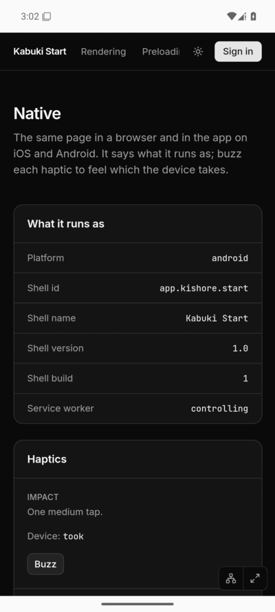
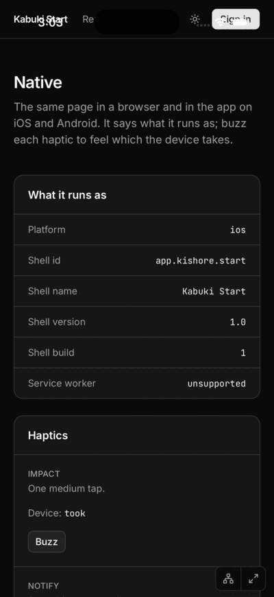

# Findings: Kabuki Start in a Capacitor shell

What the spike learned, November 2026. **Seen in CI** means a
[`native-kabuki-start.yml`](../../../.github/workflows/native-kabuki-start.yml)
job showed it, against the pull request's preview
(`https://pr139-start.kishore.app/native?proof=1`); the screenshots below are
from [run 43548855640](https://github.com/pkishorez/monorepo/actions/runs/43548855640), and the same results came in
[run 43546197876](https://github.com/pkishorez/monorepo/actions/runs/43546197876).
**Not verified** means nobody has seen it.

| Android                          | Android, offline                                  | iOS, App-Bound Domains off                                    | iOS, App-Bound Domains on                                   |
| -------------------------------- | ------------------------------------------------- | ------------------------------------------------------------- | ----------------------------------------------------------- |
|  |  |  |  |

## App Info: each shell says who it is

Seen in CI. On both platforms the page showed platform `android` or `ios`
and the shell id `app.kishore.start`, name `Kabuki Start`, version `1.0`,
build `1`. Only native code knows the id, so the page did reach the
native side and come back (`@capacitor/app`'s `getInfo`; the iOS output
shows `To Native ->  App getInfo`).

## Haptics on iOS

Seen in CI, with App-Bound Domains off and on. All three haptics answered
`true` (`took`), and the app's output shows each native call:

```
⚡️  To Native ->  Haptics impact …
⚡️  To Native ->  Haptics notification …
⚡️  To Native ->  Haptics selectionStart …
⚡️  To Native ->  Haptics selectionChanged …
⚡️  To Native ->  Haptics selectionEnd …
```

A simulator has no Taptic Engine. This proves the call reached iOS's
feedback generators, not that a hand feels it. Not verified on a phone.

## Haptics on Android

Seen in CI. The web's own `navigator.vibrate` works inside the web view:


- After a tap (a click sent over the DevTools Protocol, which the page
  takes as a touch) all three answered `took`.
- The vibrator service recorded them: `dumpsys vibrator_manager` lists
  five `finished` vibrations with usage `TOUCH` from `app.kishore.start`,
  each a few milliseconds long, as the page's patterns are. The emulator
  has no motor, so this is the system taking them, not a buzz anyone felt.
- Without a tap the web view refuses, as Chrome does: on the offline
  relaunch the automatic run logged "Blocked call to navigator.vibrate
  because user hasn't tapped on the frame" and answered `refused`. On the
  first launch the automatic run answered `took`; Playwright had attached
  to the page before it ran, which may have counted as a touch. Not
  explained.

So Android needs no haptics folder of its own for buzzes that answer a
touch, which is what haptics are for. A buzz with no touch before it (a
message arriving) would need `@capacitor/haptics` on Android too. Not
verified on a phone.

## Service worker

Seen in CI:

| Shell                      | Service worker                                     |
| -------------------------- | -------------------------------------------------- |
| Android                    | `controlling`                                      |
| iOS, App-Bound Domains off | `unsupported`: no `navigator.serviceWorker` at all |
| iOS, App-Bound Domains on  | `controlling`                                      |

Offline, Android: with the worker in control, the job turned airplane mode
on, closed the app and opened it again. The page drew in full from the
worker: the screenshot shows the airplane and the page, and the Sign in
button is gone, as the Auth Worker cannot be reached. Seen in CI. iOS
offline was not tried: a simulator shares the Mac's network.

What a seamless offline app would still need:

- On iOS, App-Bound Domains. They limit the web view to the listed domains
  (at most ten), so a sign-in or payment page on another domain has to open
  outside the app. Not verified with sign-in.
- A network for the first launch: the shell carries no copy of the site,
  so a first launch offline shows the web view's error page. Not verified.
- Data: the page drew, but anything from a Loader or an API needs the
  network, or what Replica keeps on the device.

## pnpm

Seen locally and in CI:

- No workaround. `cap add` and `cap sync` found `@capacitor/app` and
  `@capacitor/haptics` through pnpm's links, with no hoisting, no
  `node-linker` setting and no patch. Gradle and Swift Package Manager
  built them from there after a plain `pnpm install --frozen-lockfile`.
- The generated `android/capacitor.settings.gradle` and
  `ios/App/CapApp-SPM/Package.swift` point into pnpm's store by relative
  path, for example
  `node_modules/.pnpm/@capacitor+haptics@8.0.1_@capacitor+core@8.6.2/…`.
  The folder names carry versions, so a version bump changes them: run
  `cap sync` and commit. CI syncs before it builds, so a stale copy cannot
  break it.
- `@capacitor/haptics` is pinned to 8.0.1. 8.0.2 was published by hand,
  without the provenance 8.0.1 has, and the repo's `trustPolicy:
  no-downgrade` refuses it.
- `capacitor.config.js` is CommonJS. The CLI reads a `.js` config with
  `require()` and takes `module.exports` as it is, so an ES module comes
  back wrapped in `default`; a `.ts` config needs TypeScript resolvable from
  the app, which here only works because the repo root has it.
- The Capacitor CLI writes the native projects in its own style, so they
  are kept out of the formatter (`vite.config.ts`).

## Capacitor wrinkles

- iOS keeps a navigation in the app only if its URL starts with the whole
  `server.url`, query included. With `/native?proof=1` as the URL, a link
  to `/` would open Safari, so the config allows the site's host. Read in
  Capacitor's source; not seen in CI.
- A fresh emulator may launch the app before its network resolves names;
  the web view then keeps its error page (`net::ERR_NAME_NOT_RESOLVED`),
  and Capacitor does not retry. The CI step opens the page again. A phone
  that starts the app offline would show the same page. Seen in CI.
- A plain `chromium.connectOverCDP` fails on Android's web view ("Browser
  context management is not supported"); Playwright's `_android` works.
  Seen in CI.
- The iOS simulator took about eight minutes to boot ("Waiting on Data
  Migration"); the page proved itself within a minute after. Seen in CI.

## Not tested

- A real iPhone or Android phone: no feel of a haptic, no real offline.
- Store signing, App Store or Play review, push notifications, sign-in in
  the web view.
- A release build. CI builds debug, where Capacitor logs and the web view
  can be inspected.

To try it on a phone, follow the
[README's Usage](../README.md#install-on-an-iphone-with-a-free-apple-id):
Android from the `native-android` artifact's `app-debug.apk`; iOS from
Xcode on a Mac with a free Apple ID (Personal Team, trust the developer on
the phone, run again every 7 days).

## Open questions

- Should the iOS shell turn on App-Bound Domains? It is the only way to a
  service worker, at the cost of where the web view may go.
- Should a first launch with no network show a page of the shell's own
  (`server.errorPath`)?
- How does sign-in work in the web view: the `auth.kishore.app` cookie
  across the site's hosts, and Google's sign-in, which refuses embedded web
  views?
- Should the shell's version and build follow the site's release, and when
  does a native change need a store release?
- For a buzz with no touch before it, is `@capacitor/haptics` on Android
  worth adding?
